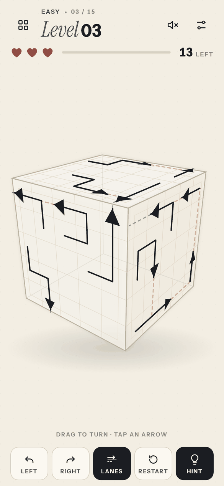
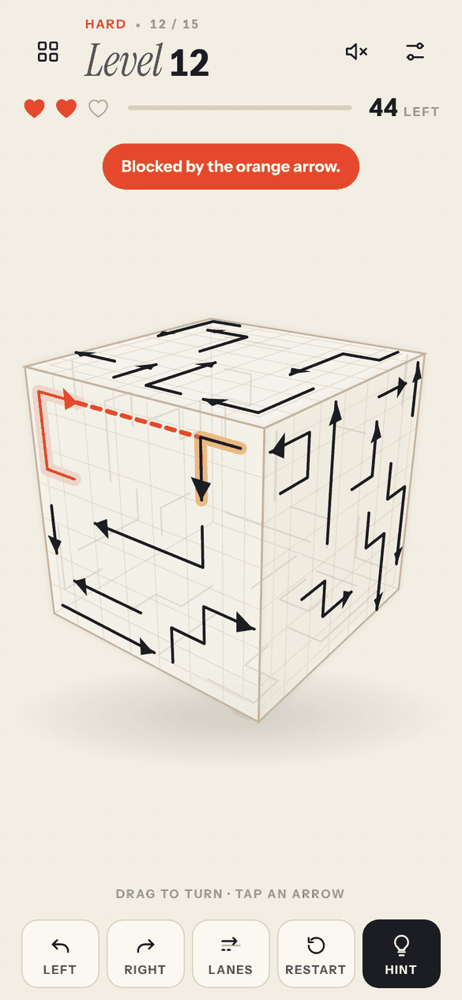
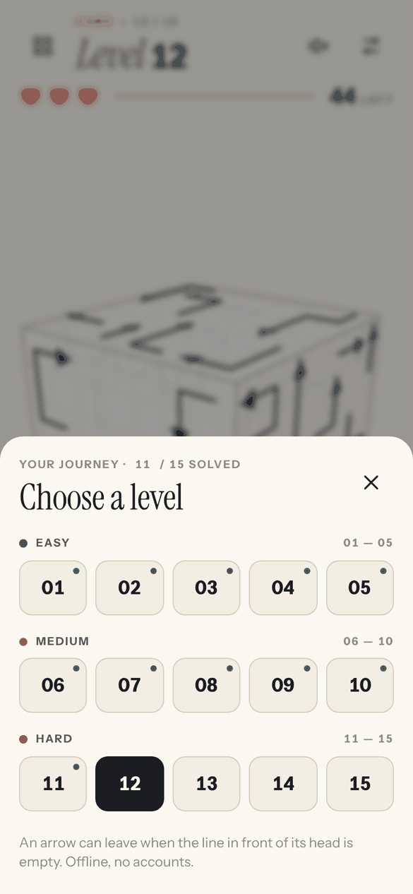

# Arrow Cube Away — 3D Puzzle

A complete, original, mobile-friendly **3D arrow escape puzzle** built in plain HTML, CSS and JavaScript. No dependencies, frameworks, sign-ups, third-party assets, or build pipeline.

## Play

- **Drag** the cube with mouse or touch to examine different faces. Or use the rotate buttons.
- **Tap** a visible arrow to slide it out along the direction of its head.
- An arrow is **blocked** only if another arrow sits in the straight line **in front of its head** on the same face. What you see is what is enforced: if the lane ahead of the head is clear, it escapes.
- Clear free arrows first, then newly unblocked arrows. Clear all faces to finish.
- A blocked tap removes one heart. You have three hearts per attempt. Hints are unlimited.
- Fifteen levels in three tiers: **Easy (1–5), Medium (6–10), Hard (11–15)**.
- **Lanes** (dock button) draws every arrow's exit lane: green when clear, red where something stands in it.
- Optional colorful arrow mode, sound effects, auto-saved unlocked levels and current level, and offline support.

## Look and feel

Vellum paper, ink arrows, and a single vermilion accent that is only spent on mistakes. The glass cube shows its
back faces faintly, a blocked tap draws the lane in red and lights the blocking arrow in amber, and the whole UI is
one phone-sized column (a bottom sheet for levels, a dock for controls) that also sits centred on desktop.

| Play + Lanes | Why it was blocked | Level sheet |
|---|---|---|
|  |  |  |

Key art (`design/key-art.png`) is drawn from the real Level 12 board; the visual philosophy behind it is in
`design/philosophy.md`. Fonts: Instrument Sans + Instrument Serif (OFL), bundled in `fonts/`.

## Run locally

Open `index.html` in a browser. For full progressive-web-app offline installation support, serve from localhost instead:

```bash
python -m http.server 8000
```

Then visit http://localhost:8000. This is a static site. No npm install needed.

## Publish to GitHub Pages

1. Open the GitHub repository `EdamMuniif/ACA-3D`.
2. Keep **all files in the repository root**, especially `index.html` (leave `tests/` inside its folder).
3. Go to **Settings → Pages → Build and deployment → Deploy from a branch**, choose `main` and `/ (root)`, and save.
4. Your game will be served at `https://EdamMuniif.github.io/ACA-3D/` after GitHub finishes publishing.

Alternatively, use Git:

```bash
git init
git add .
git commit -m "Add Arrow Cube Away 3D playable game"
git branch -M main
git remote add origin https://github.com/EdamMuniif/ACA-3D.git
git push -u origin main
```

The app uses relative paths, so it works at GitHub Pages repository subpaths. After the first successful online load, the service worker caches the game for offline play in supporting browsers.

## Design & puzzle guarantees

- `core.js`: deterministic puzzle generation (best of several seeds, scored by dependency depth), head-ray blocking, and level config. Independent of rendering, making it easy to test.
- `game.js`: perspective-projected 3D cube, touch/mouse rotation, arrow picking, animation, hearts, hints, level navigation, settings, and save data.
- `styles.css` and `index.html`: mobile-first interface (design tokens at the top of `styles.css`).
- `sw.js`: static offline caching (registered over HTTP(S), not `file://`).

Each generated arrow is admitted only if its head ray is clear **with all previously placed arrows present**. Consequently, removing arrows in reverse insertion order is always a valid solution. This makes every generated level solvable, without relying on random player guessing. Faces can be solved independently; arrow collisions don't extend between distinct cube faces.

This is a standalone interpretation of the arrow-escape puzzle concept, not a pixel-for-pixel copy of another game's proprietary art or level data.

## Test puzzle logic

```bash
node --test tests/logic.test.cjs
```

No packages are required. Browser smoke checks can be run with any modern Chromium, Firefox, or Safari browser.

## Accessibility / controls

- Touch, mouse, and keyboard work for cube rotation (arrow keys when the canvas is focused).
- `H` triggers a hint while the canvas is focused.
- Controls have labels and visible focus states.
- The game has a reduced-motion CSS mode and is responsive to mobile sizes.

## Notes

- Game progress is saved to `localStorage` on the current browser/device only, not synced to an account.
- Clearing site data also clears progress.
- On restrictive browsers or private mode, storage and sound may not be available; gameplay remains functional.
- Future expansions could include new handcrafted levels, 3D path bridges between faces, undo mode, and alternative skins.